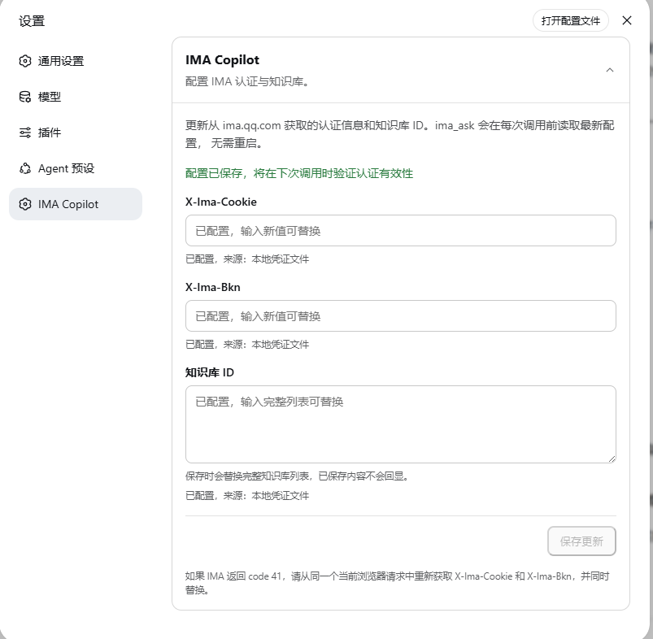

# dsh-ima-copilot

腾讯 IMA Copilot 的 DeepSeek Harness 原生插件。它将知识库问答注册为 `ima_ask` 工具，
让 Agent 可以按问题语义检索 IMA 知识库、归纳答案并返回引用资料，无需额外运行 MCP、
Python 服务或常驻子进程。



## 功能

- 使用原生 `ima_ask` 工具查询一个或多个 IMA 知识库。
- 返回回答正文以及资料 ID、标题和知识库名称等引用信息。
- 通过 Web 设置页维护认证信息和知识库 ID，更新后无需重启 DSH。
- 提供超时、并发限制、瞬时失败重试和请求取消处理。
- 凭证仅通过 DSH Credentials API 读写，不在 Web 页面回显。

## 安装

运行环境：

- Node.js `^22.19.0` 或 `>=24.0.0`
- 兼容的 DSH 版本见[版本兼容验证矩阵](#版本兼容验证矩阵)
- Web 设置页需要 `@deepseek-ai/dsh-client-ui-settings-plugins`

从 npm 安装：

```sh
dsh plugin --profile web add dsh-ima-copilot
dsh web
```

也可以从 GitHub 安装：

```sh
dsh plugin --profile web add https://github.com/onclaw-dev/dsh-ima-copilot.git
dsh web
```

安装后重启 Web profile。以下命令的输出中应包含 `ima-copilot`：

```sh
dsh --profile web --dump-config
```

## 配置

打开“设置 → 插件 → IMA Copilot”，填写：

| 字段 | DSH 凭证引用 | 说明 |
| --- | --- | --- |
| X-Ima-Cookie | `IMA_X_IMA_COOKIE` | IMA 请求的完整 Cookie |
| X-Ima-Bkn | `IMA_X_IMA_BKN` | IMA 请求头中的业务密钥 |
| 知识库 ID | `IMA_KNOWLEDGE_BASE_IDS` | 每行一个 ID，也可使用逗号分隔 |

获取配置值：

1. 登录 [IMA Copilot](https://ima.qq.com)。
2. 打开浏览器开发者工具的 Network 面板，在 IMA 中发送一条消息。
3. 找到 `/cgi-bin/assistant/qa` 请求，从同一请求的原始请求头复制完整
   `x-ima-cookie` 和 `x-ima-bkn`。不要使用包含省略号的截断值。
4. 在目标知识库页面找到 `init_session` 请求，从请求体读取
   `knowledge_base_id`。

保存知识库 ID 时需要提交完整列表，新列表会替换旧列表。设置页只显示凭证是否已配置，
不会读取或展示已保存的明文。

## 工具说明

### `ima_ask`

| 参数 | 必填 | 说明 |
| --- | --- | --- |
| `question` | 是 | 要向 IMA 知识库提出的非空问题 |
| `knowledgeBaseId` | 否 | 目标知识库 ID；配置多个知识库时必填 |

返回结果包含回答正文和引用资料：

```json
{
  "answer": "回答正文",
  "references": [
    {
      "id": "资料 ID",
      "title": "资料标题",
      "knowledgeBase": "知识库名称"
    }
  ]
}
```

配置单个知识库时插件会自动选择；配置多个知识库时必须传入列表中的
`knowledgeBaseId`。配置缺失、列表为空或 ID 不在列表中时，请求会在访问 IMA 前失败并
返回配置提示。

每次调用都会读取最新凭证、创建一次性 IMA 会话并在结束后释放资源，因此不保留跨调用的
对话历史。默认请求超时为 300 秒，瞬时失败最多重试 3 次，并发上限为 1。

## 版本兼容验证矩阵

下表最后验证于 2026-09-09。“通过”表示同一个未改写插件包已在该 DSH Release 的精确依赖
环境中完成安装、Client 启动和 Host 工具契约测试；不等同于使用真实 IMA 凭证完成在线问答。

| DeepSeek Harness Release | 适配接口 | 结果 | 说明 |
| --- | --- | --- | --- |
| `dsh-v0.1.0-rc.7` | Connection | 通过 | 已完成同包验证 |
| `dsh-v0.1.0-rc.8` | Connection | 通过 | 已完成同包验证 |
| `dsh-v0.1.1-rc.1` | Connection | 通过 | 已完成同包验证 |
| `dsh-v0.1.1-rc.2` | Connection | 通过 | 已完成同包验证 |
| `dsh-v0.1.2-alpha.1` | Gateway Remote | 不支持 | 上游 Node 24 Client Loader 缺陷，仅完成源码审计 |
| `dsh-v0.1.2-alpha.2` | Gateway Remote | 通过 | 已完成同包验证 |
| `dsh-v0.1.2-alpha.3` | Gateway Remote | 通过 | 已完成同包验证 |
| `dsh-v0.1.2-alpha.4` | Gateway Remote | 通过 | 已完成同包验证 |
| `dsh-v0.1.2-alpha.5` | Gateway Remote | 通过 | 已完成同包验证 |
| `dsh-v0.1.2-rc.1` | Gateway Remote | 通过 | 已完成同包验证 |
| `dsh-v0.1.3-alpha.1` | Gateway Remote | 不支持 | 精确依赖未发布，不能声明 registry 安装支持 |
| `dsh-v0.1.3-alpha.2` | Gateway Remote | 通过 | 已覆盖凭证服务延迟就绪场景 |
| `dsh-v0.1.5-alpha.1` | Gateway Remote | 通过 | 已完成同包验证 |

真实凭证在线验证未执行。IMA Web API 并非公开稳定 API，上游字段、鉴权或响应格式变化时，
插件可能需要同步更新。

## 许可与说明

IMA 请求与响应解析逻辑源自
[highkay/tencent-ima-copilot-mcp](https://github.com/highkay/tencent-ima-copilot-mcp)，
本项目将其适配为 DSH 原生插件，并采用 [MIT License](./LICENSE)。

DSH 是 DeepSeek Harness 的生态简称。本项目是社区插件，与腾讯 IMA 或 DeepSeek 官方均无
隶属或背书关系。使用者应自行确保账号、知识库内容和认证信息的使用符合相关服务条款。
